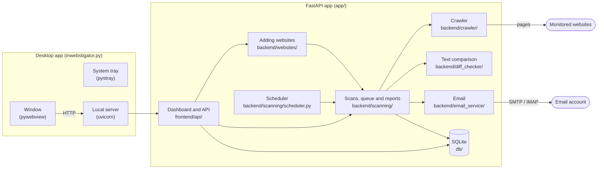
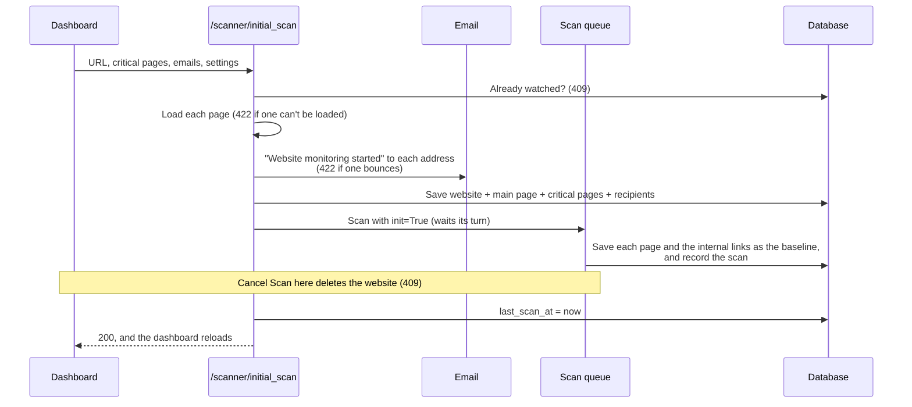
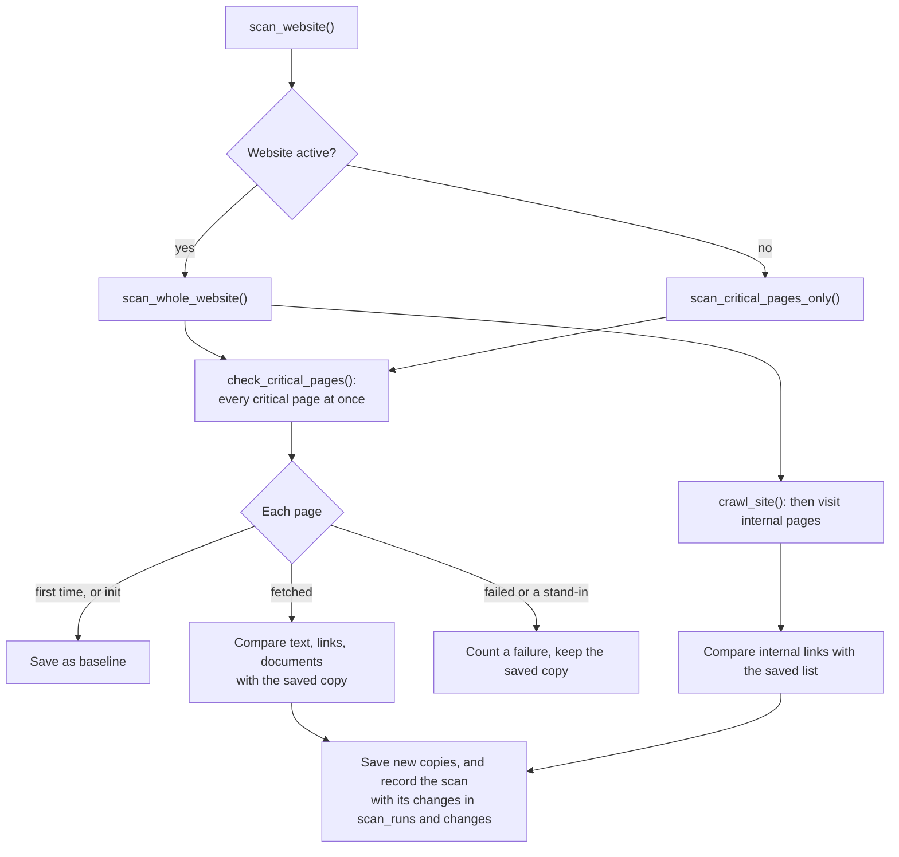
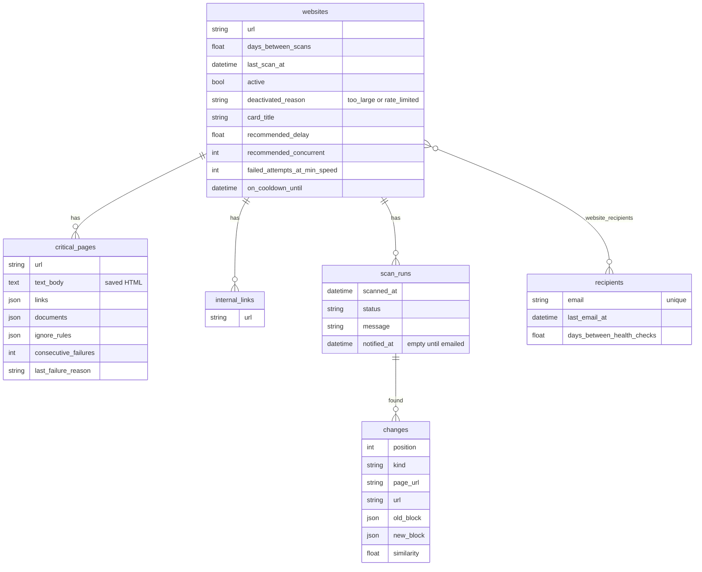

# Architecture

How Inwebstigator works, for developers changing it. For setting up and running
the project, see the [README](../README.md). Paths below are relative to `app/`.

**Contents:** [Overview](#overview) · [The desktop app](#the-desktop-app) ·
[The dashboard](#the-dashboard) · [Adding a website](#adding-a-website) ·
[Scheduling](#scheduling) · [The scan queue](#the-scan-queue) ·
[Scanning a website](#scanning-a-website) · [Change detection](#change-detection) ·
[When websites struggle](#when-websites-struggle) · [Reports and emails](#reports-and-emails) ·
[Data model](#data-model) · [Where to change things](#where-to-change-things)

---

## Overview

Everything runs in one process on the user's computer. The dashboard is
server-rendered HTML with JavaScript, served by FastAPI. Scans run inside the
same process, on its event loop, so there's no separate worker or message
queue.

When the app starts, FastAPI's lifespan (`main.py`) sets up logging (to the
terminal and a rotating file), prepares the database (see
[Data model](#data-model)), then starts the scheduler unless `AUTOMATIC_SCANS`
is off.

---

## The desktop app

`inwebstigator.py` turns the web app into a Windows desktop app:

| Thread | What it does |
| --- | --- |
| Main | Runs the pywebview window. It shows a "Starting Inwebstigator" page, then loads the dashboard once the server is ready. |
| `uvicorn` | Runs the FastAPI app on `127.0.0.1`, on port 48731 if free, otherwise any free port. |
| `system-tray` | The tray icon, with **Open**, **Hide** and **Quit**. |

- **Closing the window** only hides it, so scans carry on. **Quit** (or
  `Ctrl+C` in a terminal) stops the server and exits.
- **A Windows mutex** (`Global\Inwebstigator_SingleInstance`) stops a second
  copy starting. The second copy shows a message and exits. The installer
  checks the same mutex to ask for the app to be quit before it installs.
- **The window keeps its browser storage** in `<data dir>/webview` and uses a
  fixed port where possible, so things like the chosen theme are remembered
  between launches.
- **Settings** come from `.env` in the app's own folder (`core/paths.py`), so
  they're found even when Windows starts the app at sign-in.

The data directory is `<home>/AppData/Local/inwebstigator`. It holds the
database, the log files (`logs/`) and the window's storage. It's outside the
installed app's folder, so installing a new version keeps it, but
uninstalling deletes it.

---

## The dashboard

`GET /` (`frontend/api/routers.py`) renders `frontend/templates/index.html`
(Jinja2). The page has two tabs:

- **Websites:** a card per website, plus the Add Website wizard
  (`templates/websites/`).
- **Updates:** the last `SCANS_KEPT_PER_WEBSITE` (7) scans of each website,
  newest first, then what each scan found on each critical page
  (`templates/updates/`).

The route reads each website, its card title and its recent scans, and turns
the scans into records the templates show (`frontend/api/dashboard_records.py`).
Edited text is turned into highlighted word-by-word HTML by
`build_word_diff()`, which escapes everything it wraps.

- **Shared parts:** the header (`_header.html`), footer (`_footer.html`) and
  `<head>` (`_head.html`) are shared with the About page (`about.html`).
- **Styles and scripts** are in `static/css/` and `static/js/`, one file per
  part of the page. `_head.html` and `index.html` load them in order, which
  matters: a later stylesheet can override an earlier one (`responsive.css` is
  last), and the scripts share one scope, so each only uses what the scripts
  before it define. A test checks every file in those folders is loaded.
- **Reloading:** after an action (adding, deleting, saving settings, finishing
  a scan) the dashboard usually just reloads. The open tab is kept in the URL
  (`#updates`) and open cards in `sessionStorage`, so a reload doesn't lose
  your place. The chosen theme and "Don't show again" on the background scan
  note are kept in `localStorage`, which the desktop window keeps between
  launches.
- **Scan progress:** `static/js/scan-activity.js` asks `GET /scanner/activity`
  every 3 seconds while the window is shown, and updates each card ("Scanning
  now…", "Scan queued…", then "Scan finished") and the **Run All Scans**
  message, so scans started elsewhere (the scheduler, another window) show
  without a reload. A finished scan only says to press Refresh, rather than
  reloading by itself, so nothing being typed is lost.

**Website names** are worked out two ways:

- **Emails and the add website form** use `website_name()` (`core/urls.py`):
  the host name without "www.", plus the path if it's only part of a website,
  e.g. `example.gov.au/research`.
- **Dashboard cards** show a friendlier title from `website_card_title()`
  (`backend/websites/website_titles.py`). It's read from the site name or
  title on the saved home page where it matches the host (e.g. "UWA"),
  otherwise from the host and path (e.g. "Example News" for
  `news.example.com`). Each scan saves it in `websites.card_title`, so the
  dashboard doesn't read every home page when it loads.

### Routes

| Route | What it does |
| --- | --- |
| `GET /` | The dashboard. |
| `GET /about` | The About page: what the app does, the team and copyright. |
| `POST /scanner/initial_scan` | Adds a website and runs its first scan. See [Adding a website](#adding-a-website). |
| `POST /scanner/initial_critical_page_scan` | Adds a critical page to a website and saves its baseline. 409 if it's already watched, however it's written. |
| `POST /scanner/run` | Scans one website now (**Run scan**), and emails a "Manual scan" report if it found anything. |
| `POST /scanner/run_all` | Scans every website now, whether due or not (**Run All Scans**). 409 if one is already running. |
| `POST /scanner/cancel_all` | Cancels a running **Run All Scans**: the website being scanned is cancelled and the rest skipped. Websites already scanned keep their results, and their reports are still emailed. |
| `POST /scanner/cancel` | Cancels a website's queued or running scan. |
| `GET /scanner/activity` | The website being scanned now, those waiting their turn, and whether **Run All Scans** is running, for the dashboard to show progress. |
| `/websites`, `/critical_pages`, `/recipients` | Create, read, update and delete, from `create_crud_router()`. Updating a website confirms any added emails first. Deleting one cancels its scan. A website's main page can't be deleted (422). |

FastAPI's own API docs are at `/docs`.

### The request guard

The app has no login, so `frontend/api/request_guard.py` stops other websites
using it through the user's browser:

- **Unknown hosts are refused (400).** Only `127.0.0.1` and `localhost` are
  accepted, which stops DNS rebinding.
- **Changes need a token (403).** Every POST, PATCH and DELETE must carry the
  `X-Inwebstigator-Token` header. The token is random each time the app starts
  and is only put in the dashboard page, whose scripts add it to their
  requests.

`API_TOKEN_REQUIRED=false` turns this off, e.g. to use `/docs`.

---

## Adding a website

`add_website()` in `backend/websites/website_setup.py`:

- **Nothing is added if a check fails.** The "already watched" check matches
  however the address is written (`www.`, http or https, a trailing `/`). A
  different part of a watched website (e.g. `example.com/research`) can still
  be added.
- **One email per recipient.** "Website monitoring started" is sent before the
  scan and also confirms the address can receive email (see
  [Checking an address](#checking-an-address)).
- **The main page is always watched.** The website's own URL is saved as a
  critical page ("Main website (automatic)").
- **The first scan only saves a baseline.** It saves each page's current HTML,
  links and documents, and the site's internal links, and reports nothing.
  Later scans compare against that. A website whose first scan ran into a
  problem (e.g. it blocked the crawler) is still added, with the problem
  recorded in its first scan.

---

## Scheduling

`backend/scanning/scheduler.py` uses APScheduler, started from FastAPI's
lifespan, and only if `AUTOMATIC_SCANS` is on. Checks run at the same clock
times every day: `SCHEDULER_SCAN_TIME` (8am), then every
`SCHEDULER_MINIMUM_DAYS_BETWEEN_SCANS` (12 hours, so 8pm). One more check runs a
second after startup, to catch up on any check missed while the app or the
computer was off.

```mermaid
flowchart TD
    start(["8am, 8pm,<br/>and just after startup"]) --> all["scan_all_websites()"]
    all --> each{"For each website"}
    each -->|"on cooldown"| skip["Skip"]
    each -->|"not due yet"| skip
    each -->|"due"| scan["scan_website()"]
    scan --> record["Scan recorded, report waiting to be emailed"]
    record --> each
    each -->|"done"| send["send_reports_awaiting_email():<br/>one 'Website update' email per recipient"]
    send --> health["send_due_health_checks()"]
```

- **When a website is due** (`backend/scanning/scan_schedule.py`): time is
  counted between the checks its last scan and this run fall in, not between
  exact times. So a scan that ran late (e.g. at 3pm after the 8am check was
  missed) is still followed by one at the next usual check.
  `SCHEDULER_SCAN_DUE_TOLERANCE_MINUTES` (60) lets an interval that doesn't
  line up with the checks be scanned at the nearest one.
- **Health checks** go to each recipient who hasn't been emailed for their
  `days_between_health_checks` (7), counted from the start of the day they
  were last emailed. Any email counts. They're sent after the scans, so a
  report just sent counts, and not at all if the scans failed.
- **Run All Scans** (`scan_all_websites_now()`) runs the same loop with
  `ignore_schedule=True`, so every website is scanned except those on
  cooldown. The scheduled checks carry on at their usual times.
- **A run carries on after a failure.** A website whose scan fails is logged
  and its recipients are sent a failure report. A failed email is logged and
  kept to send next time.

---

## The scan queue

Scans run **one at a time**, in the order they were asked for, whether from
the scheduler, **Run scan**, **Run All Scans** or adding a website.

`ScanQueue` in `backend/scanning/scan_queue.py` (one shared `scan_queue`):

- **`run(url, scan)`** waits for the scans asked for before it, then runs this
  one. Asking to scan a website that's already queued raises
  `ScanAlreadyQueuedError` (409).
- **`cancel(url)`** cancels that website's scan, whether it's waiting or
  running. The request waiting for it gets `ScanCancelledError` (409), and
  nothing from the cancelled scan is saved.
- **`queued_urls`** lists the websites waiting or being scanned, and
  **`scanning_url`** is the one being scanned now. The dashboard reads them
  when it renders and from `GET /scanner/activity`, so a card shows "Scanning
  now…" or "Scan queued…" whenever the page was loaded.

`run_all_scans` (`backend/scanning/all_websites_scan.py`) tracks the one
**Run All Scans** that can run at a time, so it can be cancelled and the
dashboard can show its Cancel button after a reload.

---

## Scanning a website

`scan_website()` in `backend/scanning/website_scan.py` runs the scan through
the queue, saves what it found, and records it in the website's history:

- **Critical pages are checked first, all at once,** and failures are caught
  per page, so one broken page doesn't stop the rest. A failed page keeps its
  saved copy and its `consecutive_failures` goes up. After
  `CRITICAL_PAGE_ALERT_AFTER_FAILURES` (2) in a row it's reported as
  unreachable. A 404 or 410 is reported straight away. A page that works
  again has its count reset.
- **The crawl** (`backend/crawler/site_crawler.py`) visits pages in batches,
  up to `concurrent` at a time, waiting `delay` seconds before each request.
  It follows only links on the same website and under the website's path,
  treating `example.com` and `www.example.com` as the same. URLs are normalised
  (`core/urls.py`) so the same page written differently, e.g. with tracking
  parameters such as `utm_source`, is only visited once.
- **Internal links:** a website's first crawl just saves them. After that,
  added and removed internal links are reported.
- **Most pages missing:** if a website with at least 20 known pages loses more
  than half of them in one crawl, it's probably partly down, so nothing is
  reported as removed and the scan is recorded as `pages_missing`. After 3 such
  scans in a row, the pages are accepted as really removed.
- **Inactive websites** only have their critical pages checked. That's what
  "inactive" means, and it's why a too-large website is made inactive rather
  than dropped.
- **History:** every scan is recorded in `scan_runs`, with one row in
  `changes` per thing it found. Each website keeps its last
  `SCANS_KEPT_PER_WEBSITE` (7) scans. Older ones are deleted after each scan,
  except any whose report hasn't been emailed yet.

---

## Change detection

Comparing a critical page's saved copy with the new one
(`backend/scanning/critical_page_checks.py`, using `backend/diff_checker/`):

1. **Reading the page** (`diff_checker/page_parser.py`). The page is cleaned
   (scripts, styles, comments and text that looks like HTML tags are removed).
   The watched part is `<main>`, or else `<body>` without the page's own header
   and footer, and always without `<nav>` and `<aside>`. It's turned into a
   list of text **blocks**: paragraphs, list items, quotes and table rows. Each
   block remembers the heading it sits under. A block nested in another is
   part of the outer one, so text isn't counted twice.
2. **Ignoring text.** Text matching the page's `ignore_rules` (regular
   expressions, for text that changes on every visit) is removed first. These
   can only be set through the API (`PATCH /critical_pages/{id}`); the
   dashboard has no control for them.
3. **Spotting stand-ins.** If the new page has less than 30% of the old page's
   text (and the old page had at least 200 characters), it's probably a
   stand-in, such as a "Just a moment…" check or a maintenance page. It's
   counted as a failed check rather than as changes. After 3 stand-ins in a
   row, the new content is accepted as a real redesign.
4. **Comparing blocks** (`diff_checker/block_comparison.py`). The two lists of
   blocks are lined up and the matching runs are unchanged. Text found on both
   versions but under a different heading has **moved**. In the stretches that
   differ, blocks at least `DIFF_CHECKER_TEXT_SIMILARITY_THRESHOLD` (60%)
   similar are paired as **edited**. The rest are **added** or **removed**.
   Each block is compared with at most `DIFF_CHECKER_MAX_COMPARISONS_PER_BLOCK`
   (20) others, to keep big pages quick.
5. **Links and documents** are compared as sets. Added links are only those in
   the watched part of the page, so a change to a menu shared by every page
   isn't reported on every critical page. A link to a file such as a PDF or
   Word document counts as a document.

What a check finds is saved as rows in `changes`, and the new HTML replaces
`text_body` only when something changed.

---

## When websites struggle

`backend/scanning/scan_failures.py`:

| What happens | How it's detected | What the app does |
| --- | --- | --- |
| Rate limited or overloaded | HTTP 429, 502, 503 or 504 after retries, or a crawl batch where at least 50 pages, and at least half the batch, return 403 | Slows the website down (delay +0.5s up to 3s, concurrency halved down to 1) and pauses it for 24 hours. Once it's already at the slowest speed, each further time is counted, and after 3 the website is made **inactive** with the reason `rate_limited`. |
| Unreachable | Connection error or timeout after retries | Pauses it for 2 hours. |
| Too large | More than 50,000 pages found | Made **inactive** with the reason `too_large`. Its critical pages are still checked. |

Paused websites (`on_cooldown_until`) are skipped by scheduled runs and **Run
All Scans**. Page fetches (`backend/crawler/page_fetcher.py`) are retried with
exponential backoff (5 attempts) before any of this, waiting longer when a
server sends `Retry-After` (up to 60 seconds). Each problem is recorded as the
scan's status and goes in its report, so recipients hear about it.

---

## Reports and emails

### Reports

A scan's report is its row in `scan_runs` and its `changes`. `notified_at` is
empty until the report has been emailed (`backend/scanning/scan_reports.py`):

- **Scheduled runs and Run All Scans** call `send_reports_awaiting_email()`
  at the end. Every report not yet emailed, including ones from earlier runs
  whose email failed, goes out as one email per recipient covering all their
  websites (`backend/scanning/notifications.py`). Then `notified_at` is filled
  in.
- **Run scan** emails its own report straight away with `email_report_once()`.
- **If the mail server is down,** the reports stay waiting and go out with the
  next run. An address refused for good, or an email the server rejects (a 5xx
  reply), isn't tried again. A website with no recipients has its reports
  marked as sent.

### The emails

| Email (subject starts with) | Sent by | To |
| --- | --- | --- |
| Website monitoring started | `add_website()`, before the first scan | Each of the new website's recipients |
| Email address added to website monitoring | `update_website_settings()` | An address added to a website later |
| Website update(s) | A scheduled run or **Run All Scans** | Each recipient, one email for all their websites |
| Manual scan | **Run scan** | The website's recipients, if it found anything |
| Health check | The scheduler | Anyone not emailed for `days_between_health_checks` days, listing their websites and any that need attention |

Every successful send updates the recipient's `last_email_at`, which is what
health checks count from.

In `backend/email_service/`:

- **Wording** (subjects, times) is in `email_wording.py`. Times are shown in
  `EMAIL_TIME_ZONE`, or the computer's own time zone if it's blank.
- **HTML** is in `templates/`, rendered by `html_bodies.py`. The templates
  escape everything, as page text is untrusted. `style_inliner.py` copies the
  CSS onto each tag, as many email apps ignore `<style>`. Long lists of links
  are cut at `EMAIL_MAX_LISTED_LINKS` (100).
- **Every email is multipart:** the HTML, plus a plain-text copy made from it
  (`message_builder.py`). Each also carries `Date`, `Message-ID` and
  `Auto-Submitted: auto-generated` headers, which help it avoid spam folders
  and stop out-of-office replies.
- **Sending** (`delivery.py`, `SmtpEmailSender`) uses SSL on port 465, or
  STARTTLS on any other port, and always checks the server's certificate.
  Temporary failures (a dropped connection, a 4xx reply) are retried up to 3
  times. Permanent ones, like a failed login or a refused address, fail
  straight away.

### Checking an address

Mail servers accept an email first and report a missing mailbox later, by
sending a bounce back to the sender. So `confirm_address_can_receive_email()`
counts the bounces about the address in the sending account's inbox (over
IMAP), sends the email, then checks the inbox every 3 seconds for up to 30
seconds for a new one. The inbox is `IMAP_HOST`, or `SMTP_HOST` with `smtp.`
swapped for `imap.`. If it can't be opened, the email is just sent. Addresses
that are already recipients are emailed without waiting.

---

## Data model

- **Uniqueness:** recipients' emails are unique. A critical page's URL and an
  internal link's URL are unique **within their website**, so overlapping
  websites (e.g. `uwa.edu.au` and `uwa.edu.au/news`) can share pages.
- **Deleting** a website deletes its critical pages, internal links and scan
  history. Recipients are shared between websites, so they're only unlinked.
- **Times are saved in UTC** (`UTCDateTime` in `db/schema.py`). Saving a time
  without a time zone is an error. The dashboard shows times in the computer's
  time zone, and emails in `EMAIL_TIME_ZONE`.
- **Database access** goes through `db/services/` (one service per table) and
  `db/repository.py`. Request handlers get a session from `get_db_session()`,
  which commits at the end of the request. Background work uses `db_context()`
  (both in `db/session.py`).
- **Upgrades:** `prepare_database()` in `db/migrations.py`. See
  [Database in the README](../README.md#database).

---

## Where to change things

| To change… | Look at |
| --- | --- |
| What's shown on the dashboard | `frontend/templates/`, `frontend/static/css/` and `js/`, and `frontend/api/dashboard_records.py` |
| What counts as a text change | `backend/diff_checker/` |
| Which pages the crawler visits | `backend/crawler/`, and `core/urls.py` for how URLs are matched |
| How a scan runs and what it saves | `backend/scanning/website_scan.py`, `change_detection.py`, `critical_page_checks.py` |
| When scans and health checks happen | `backend/scanning/scheduler.py`, `scan_schedule.py`, `health_checks.py` |
| What's emailed, and its wording | `backend/scanning/scan_reports.py`, `backend/email_service/` |
| How a struggling website is handled | `backend/scanning/scan_failures.py` |
| Adding websites, pages and emails | `backend/websites/` |
| Defaults and limits | `core/config.py` |
| The database | `db/schema.py`, plus a one-off update in `db/migrations.py` if existing databases need changing |
